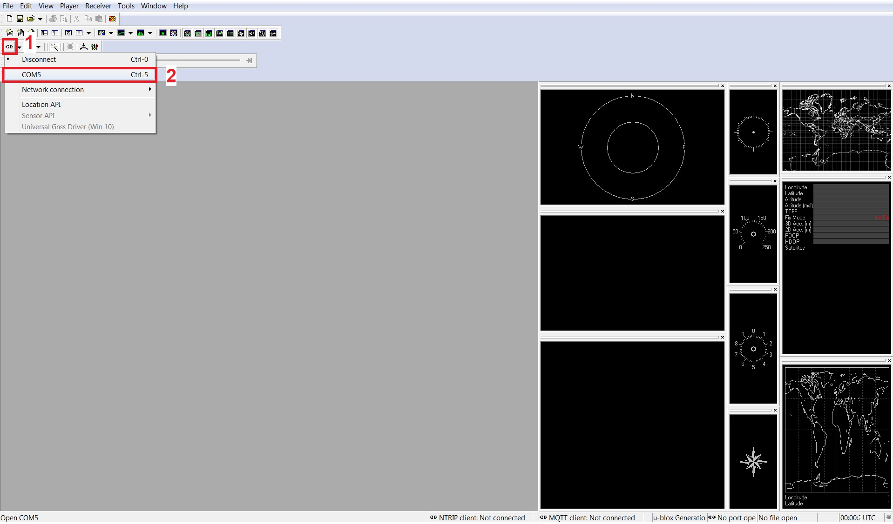
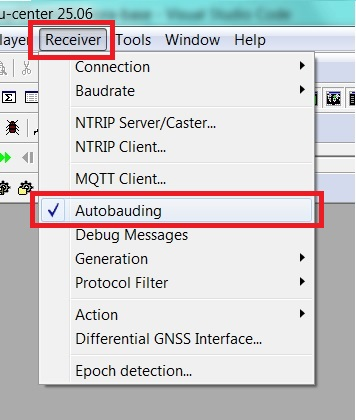
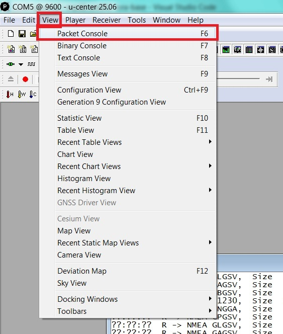
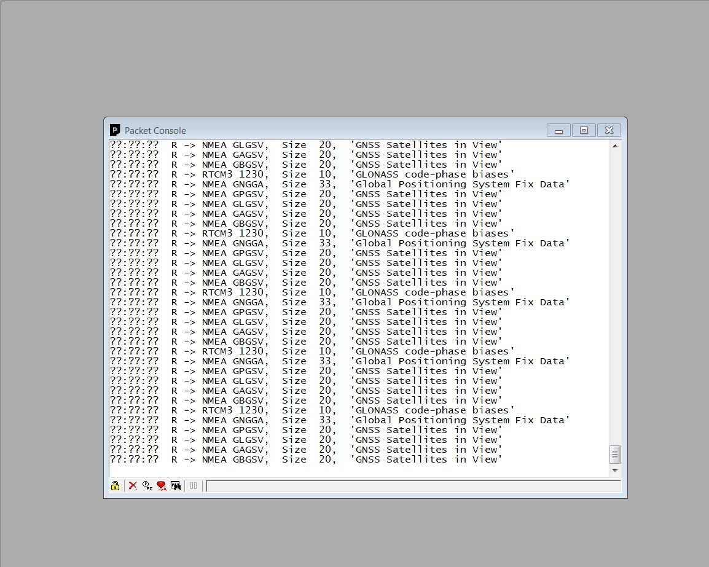
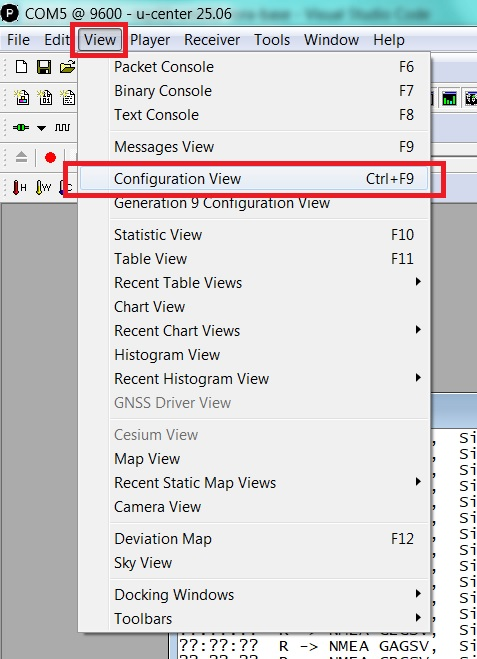
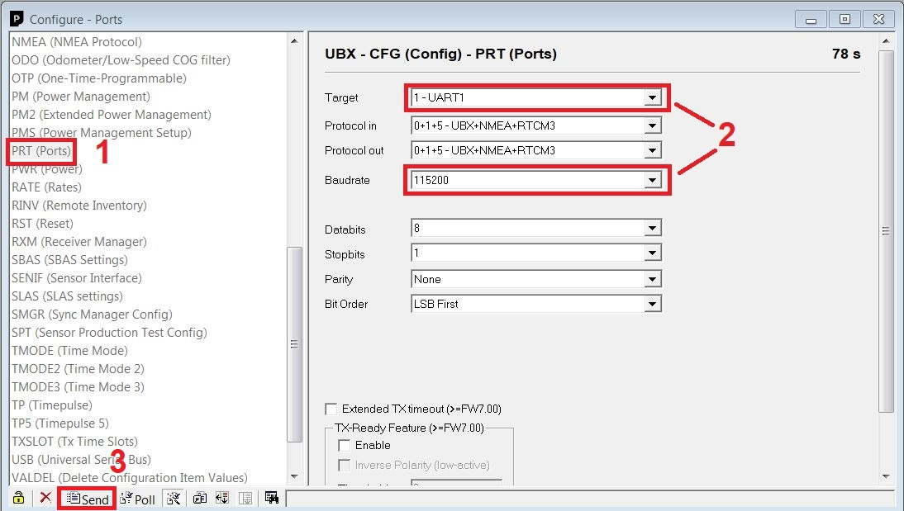
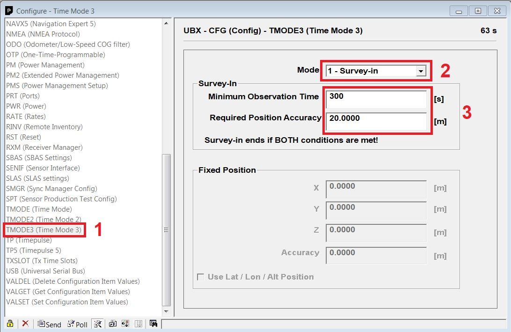
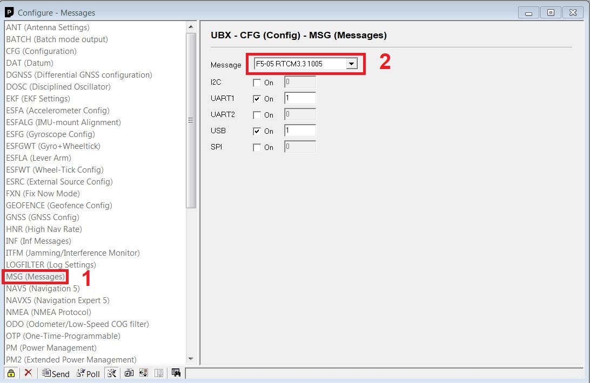

# AITOGY-GNSS-BASE-ESP-UBX

**Hướng dẫn khách hàng | Firmware V2.3.5 | Cập nhật 25/10/2026**

## 1. Phạm vi và nguyên tắc vận hành

Bộ AITOGY-BASE-ESP nhận dữ liệu từ receiver GNSS, chuyển tiếp RTCM lên caster bằng 4G hoặc Wi-Fi và nhận điều khiển từ hệ thống CORS. Anten base phải đứng yên khi phát cải chính. Sau khi di chuyển anten, cấu hình lại tọa độ base trước khi cho rover sử dụng.

Tài liệu mô tả firmware **V2.3.5**, cập nhật **25/10/2026**. Kết quả biên dịch và kiểm tra phần mềm không thay thế nghiệm thu ngoài thực địa. Không cam kết thời gian khởi động cố định hay độ chính xác đo khi chưa kiểm tra receiver, anten, mạng cải chính và hệ tọa độ.

| Chế độ | Khi sử dụng | Điều kiện hoàn thành |
| --- | --- | --- |
| FIXED_LLA | Đã có tọa độ điểm đặt anten đáng tin cậy. | Gửi cấu hình fixed, kiểm tra tọa độ receiver và luồng RTCM. |
| SURVEY_IN | Cần receiver tự khảo sát vị trí đứng yên. | Receiver kết thúc khảo sát; gửi lệnh thành công không có nghĩa khảo sát đã xong. |
| AUTO_CORS | Có tài khoản rover nhận cải chính từ CORS. | Chuyển rover, nhận cải chính, lấy mẫu RTK_FIXED, đặt lại base và kiểm tra phát RTCM. |

Độ cao phải dùng đúng quy ước của tọa độ cung cấp. Với cấu hình fixed theo LLA, sử dụng độ cao ellipsoid. Không thay trực tiếp bằng độ cao thủy chuẩn hoặc bỏ qua chiều cao anten/điểm quy chiếu.

## 2. Kết nối và chuẩn bị

| Đường tín hiệu TDM240x | Kết nối |
| --- | --- |
| GPIO18 / RX GNSS của ESP32 | Nhận từ TX của receiver GNSS. |
| GPIO19 / TX GNSS của ESP32 | Gửi vào RX của receiver GNSS. |
| GND | Chung mass giữa ESP32, receiver và bộ nguồn theo thiết kế bộ thiết bị. |
| GPIO16 / RX modem | Nhận từ TX modem. |
| GPIO17 / TX modem | Gửi vào RX modem. |
| Serial console | 115200 baud; gửi một dòng lệnh và kết thúc bằng LF. |
| UART GNSS | Mặc định 115200 baud, 8N1. |

Đối chiếu nhãn cổng và sơ đồ của đúng board trước khi đấu dây. Không suy ra chân cắm hay mức nguồn từ hình ảnh của board khác. Gắn anten GNSS đúng cổng, đặt nơi thoáng trời, cố định cơ khí; kiểm tra SIM/APN và anten 4G trước khi chạy auto base.

Bản u-blox dùng receiver hỗ trợ các lệnh cấu hình mà firmware tạo, mục tiêu là dòng ZED-F9P phù hợp. Nối UART1 receiver tới RX18/TX19 ESP32. Một số receiver/phiên bản chỉ hỗ trợ một phần CFG-VALSET hoặc TMODE3; không suy luận mọi receiver u-blox đều tương thích.

## 3. Cấu hình mặc định và thông tin cần bàn giao

| Thông số | Giá trị/ý nghĩa trong firmware |
| --- | --- |
| Kết nối mạng | 4G; có thể chuyển Wi-Fi bằng ATG. |
| APN | v-internet; thay theo SIM thực tế. |
| MQTT broker mặc định | 45.117.179.134:1883; phải khớp hệ thống CORS đang triển khai. |
| Backend WebSocket | base.aitogy.com:8000, giao thức ws; cần endpoint thiết bị thực sự truy cập được. |
| Caster dự phòng trong cấu hình mặc định | aitogy.com.vn:2101, mountpoint /test; không phải thông tin cấp phát cho mọi khách hàng. |
| Kênh quản lý chính | Topic theo serial esp_... do thiết bị tạo; quản trị viên cấp quyền trên CORS. |
| Trạng thái backend | Chu kỳ mặc định 5 giây; kết nối mạng có thể làm chậm việc gửi. |
| Health kiểu cũ | Chu kỳ mặc định 30 giây. |

Đơn vị triển khai bàn giao: serial, tên trạm, loại GNSS, caster/mountpoint phát, tài khoản cải chính đầu vào nếu dùng AUTO_CORS, APN hoặc Wi-Fi và người quản lý trên CORS. Mật khẩu/token do quản trị viên cấp riêng, không lấy từ ví dụ trong tài liệu.

## 4. Đưa thiết bị lên CORS

1. Cấp nguồn ổn định, mở console 115200 baud và ghi lại serial `esp_...`, phiên bản firmware, loại chip, baud nhận diện được.
2. Cấu hình mạng, MQTT và backend theo triển khai. Các chuỗi trong dấu `<...>` là giá trị cần thay, không nhập nguyên dấu ngoặc.
3. Lưu thông tin trước, gửi lệnh chọn mạng sau cùng vì lệnh đó khởi động lại thiết bị.
4. Trên CORS, quản trị viên nhận/cấp thiết bị, đặt tên, triển khai license và chọn đúng loại chip.
5. Triển khai dịch vụ caster: server 1, server 2 nếu cần, mountpoint, tài khoản phát và chế độ luôn phát/theo yêu cầu.
6. Chọn FIXED_LLA, SURVEY_IN hoặc AUTO_CORS. Theo dõi kết quả lệnh và tiến độ, sau đó kiểm tra luồng RTCM bằng rover độc lập.

Ví dụ cấu hình 4G:

```text
ATG ESP SET 4G APN <apn>
ATG MQTT SET SERVER <mqtt_host>
ATG MQTT SET PORT 1883
ATG MQTT SET USER <mqtt_user>
ATG MQTT SET PASS <mqtt_password>
ATG ESP SET BACKEND HOST <backend_host>
ATG ESP SET BACKEND PORT 8000
ATG ESP SET CONNECTION 4G
```

Ví dụ đổi sang Wi-Fi:

```text
ATG ESP SET WIFI SSID <ssid>
ATG ESP SET WIFI PASS <wifi_password>
ATG ESP SET CONNECTION WIFI
```

Console ATG tách tham số theo dấu cách, không hỗ trợ chuỗi có khoảng trắng hoặc giá trị rỗng. Nếu SSID/mật khẩu cần dạng này, liên hệ kỹ thuật; không dùng dấu nháy để giả lập chuỗi.

Thiết bị chưa được cấp quyền hoặc chưa có license vẫn có thể báo trạng thái nhưng không đủ điều kiện phát RTCM. Trạng thái `online` của kênh quản lý cũng chưa chứng minh rover nhận được cải chính.

## 5. Chọn chế độ base và xác nhận kết quả

### 5.1 Tọa độ cố định

Nhập vĩ độ/kinh độ dạng độ thập phân và độ cao ellipsoid tính bằng mét. Kiểm tra đúng điểm quy chiếu anten và hệ tọa độ. Sau khi cấu hình, đối chiếu tọa độ đọc từ receiver, sự hiện diện của bản tin tọa độ base và tọa độ rover tại điểm kiểm tra.

### 5.2 Survey-in

Đặt anten đứng yên, nhập thời gian khảo sát theo giây. Nhánh u-blox cấu hình TMODE3 với cả thời gian tối thiểu và giới hạn độ chính xác. Receiver tự quyết định kết thúc survey theo điều kiện cấu hình; theo dõi trạng thái thực tế sau khi gửi.

Survey-in không tự tạo ra tọa độ tuyệt đối đạt độ chính xác khảo sát chỉ vì chọn ngưỡng nhỏ. Khi cần tọa độ gắn với hệ quy chiếu cụ thể, dùng điểm đã biết hoặc AUTO_CORS và thực hiện kiểm tra độc lập.

### 5.3 Auto base từ CORS

Firmware chuyển receiver sang rover, nhận RTCM từ mountpoint cải chính và chỉ chấp nhận GGA mới với trạng thái **RTK_FIXED**. RTK_FLOAT không được dùng làm mẫu auto base.

Luồng mặc định cần 5 lần kiểm tra FIX liên tiếp theo nhịp khoảng 1 giây, sau đó lấy tối đa 60 mẫu trong cửa sổ 60 giây. Cần ít nhất 15 mẫu hợp lệ để tiếp tục; không mặc định coi kết quả luôn có đủ 60 mẫu. Thiết bị đặt lại tọa độ base rồi khôi phục dịch vụ phát đã cấu hình.

Thời gian chờ FIX mặc định 3600 giây; quản trị viên có thể cấu hình theo nghiệp vụ. Khi mất FIX, mất kết nối, thiếu mẫu hoặc có lệnh dừng, xem lý do trong tiến độ workflow. Việc khôi phục kết nối caster sau thất bại không tự chứng minh receiver đã trở về cấu hình base mong muốn.

Phần chuyển VN2000 hiện dùng tham số tích hợp và phép chiếu theo lựa chọn tỉnh/kinh tuyến. Firmware không giải mã các bản tin datum RTCM 1021/1023/1025. Phải đối chiếu mốc kiểm tra thực địa; không coi nhãn VN2000 là chứng nhận độ đúng hệ tọa độ.

## 6. Theo dõi trạng thái và luồng dữ liệu

| Hiển thị/trường | Cách hiểu |
| --- | --- |
| awaiting_license / unprovisioned | Chưa đủ điều kiện cấp quyền/license để phát RTCM. |
| locked | Thiết bị bị khóa toàn bộ; liên hệ quản trị viên. |
| sleep | Đang chờ kích hoạt luồng theo yêu cầu; chưa chắc là mất mạng. |
| online | Kênh quản lý hoạt động; cần kiểm tra thêm từng server NTRIP. |
| auto_setup_* / reference_check* | Workflow đang thực hiện một bước cấu hình hoặc kiểm tra. |
| last_command_result | Kết quả xử lý lệnh; lệnh khởi động workflow thành công chỉ nghĩa đã nhận việc. |
| auto_base_progress | Theo dõi phase, số mẫu và lý do completed/failed/stopped của workflow. |
| server1/2_connected và server1/2_bps | Kết nối và số byte/giây gửi tới từng caster. |
| rtcm_input_bps | Số byte RTCM/giây được đóng khung ở UART; không phải chứng nhận CRC hợp lệ. |
| GGA/fix/satellites | Chất lượng nghiệm GNSS và dữ liệu vị trí đang nhận. |

Ví dụ cấu trúc health kiểu cũ (giá trị minh họa):

```json
{
  "uptime_s": 120,
  "free_heap_bytes": 120000,
  "connected_via": "GSM",
  "rssi_dbm": 20,
  "mqtt_ok": true,
  "ntrip_ok": true,
  "gnss_data_ok": true,
  "rtcm_decoder": false,
  "rtcm_types": {}
}
```

`connected_via` dùng `GSM` hoặc `WiFi`. `gnss_data_ok` phản ánh đã nhận khung RTCM gần đây, trong ngưỡng 5 giây của tác vụ health. `rtcm_types` rỗng vì ESP32 không đếm từng loại bản tin. `rssi_dbm` là tên trường cũ: Wi-Fi dùng RSSI, còn 4G đang giữ giá trị chất lượng tín hiệu thô do modem trả về, chưa tự chuyển sang dBm. Không dùng giá trị đó như số dBm 4G đã hiệu chuẩn.

Hệ thống nhận NMEA GGA/GSA/GSV/GST để theo dõi GNSS. ESP32 không mặc định tạo một bản sao toàn bộ RTCM lên MQTT. Các trường có tên `valid_packets` hiện là bộ đếm đóng khung, không có kiểm tra CRC RTCM. `hacc` có thể lấy từ GST hoặc fallback HDOP; không coi mọi giá trị `hacc` đều là độ chính xác mét đã xác nhận.

## 7. Danh mục lệnh ATG

ATG dùng để cấu hình kết nối và hỗ trợ kỹ thuật. Ưu tiên CORS để cấu hình base và đọc kết quả lệnh theo từng thiết bị. Từ khóa dùng đúng chữ hoa; mỗi dòng kết thúc bằng LF. Lệnh SET thường lưu cấu hình, cần khởi động lại để kết nối đọc lại giá trị mới.

### 7.1 ESP và mạng

| Cú pháp | Tác dụng |
| --- | --- |
| `ATG ESP RESTART` | Khởi động lại ngay. |
| `ATG ESP SET CONNECTION 4G` | Lưu chọn 4G và khởi động lại. |
| `ATG ESP SET CONNECTION WIFI` | Lưu chọn Wi-Fi và khởi động lại. |
| `ATG ESP SET WIFI SSID <ssid>` | Lưu SSID không có khoảng trắng. |
| `ATG ESP SET WIFI PASS <password>` | Lưu mật khẩu không có khoảng trắng. |
| `ATG ESP SET 4G APN <apn>` | Lưu APN. |
| `ATG ESP SET 4G USER <user>` | Lưu tên đăng nhập APN khi nhà mạng yêu cầu. |
| `ATG ESP SET 4G PASS <password>` | Lưu mật khẩu APN khi nhà mạng yêu cầu. |
| `ATG ESP SET BACKEND HOST <host>` | Lưu hostname/IP của endpoint WebSocket, không kèm scheme hoặc đường dẫn. |
| `ATG ESP SET BACKEND PORT <port>` | Lưu cổng WebSocket; chấp nhận 1-65535. |

### 7.2 MQTT và NTRIP phát

| Cú pháp | Tác dụng |
| --- | --- |
| `ATG MQTT SET SERVER <host>` | Lưu broker MQTT. |
| `ATG MQTT SET PORT <port>` | Lưu cổng MQTT; nhập số hợp lệ 1-65535. |
| `ATG MQTT SET USER <user>` | Lưu tên đăng nhập broker. |
| `ATG MQTT SET PASS <password>` | Lưu mật khẩu broker. |
| `ATG MQTT SET PUBTPCHEALTH <topic>` | Lưu topic health kiểu cũ. |
| `ATG MQTT SET SUBTPCCMD <topic>` | Lưu topic subscribe ATG kiểu cũ; thay topic cần kỹ thuật kiểm tra callback thực nhận. |
| `ATG NTRIP SET CSTRADDR <host>` | Lưu caster mặc định/dự phòng. |
| `ATG NTRIP SET CSTRPORT <port>` | Lưu cổng caster; nhập số hợp lệ 1-65535. |
| `ATG NTRIP SET MNTPNT <mountpoint>` | Lưu mountpoint mặc định. |
| `ATG NTRIP SET CSTRAUTH <password>` | Lưu mật khẩu source nguyên văn; không nhập base64 của username:password. |

Dịch vụ đã cấp từ CORS có thể ưu tiên hơn cấu hình NTRIP mặc định lưu bằng ATG. Muốn thay tài khoản/mountpoint đang vận hành, chỉnh dịch vụ trên CORS rồi triển khai lại.

### 7.3 GNSS và đặt lại cấu hình

| Cú pháp | Tác dụng |
| --- | --- |
| `ATG GNSS ROVER` | Chuyển receiver sang rover để chẩn đoán; không tự đăng nhập tài khoản rover CORS. |
| `ATG GNSS BASE SURVEY_IN <seconds> <accuracy_m>` | Gửi batch survey-in theo loại chip; mặc định chỉ xuất RTCM, không xuất NMEA diagnostic. |
| `ATG GNSS BASE SURVEY_IN <seconds> <accuracy_m> W_DIAG` | Survey-in và xuất cả RTCM lẫn các bản tin NMEA diagnostic; `W_DIAG` không phân biệt hoa thường. |
| `ATG GNSS BASE FIXED <lat> <lon> <alt> <accuracy_m>` | Gửi tọa độ LLA cố định; độ cao tính bằng mét ellipsoid. |
| `ATG GNSS BASE <message> <port> ON` | Bật bản tin RTCM trên cổng chỉ định. |
| `ATG GNSS BASE <message> <port> OFF` | Tắt bản tin RTCM trên cổng chỉ định. |
| `ATG GNSS BASE ALL <port> <ON/OFF>` | Bật hoặc tắt toàn bộ các bản tin RTCM được firmware hỗ trợ trên cổng chỉ định. |
| `ATG GNSS SET CHIP UBLOX` | Lưu lựa chọn chip và khởi động lại; boot vẫn thực hiện nhận diện phần cứng. |
| `ATG CONFIG RESET` | Đặt cờ nạp lại mặc định và khởi động lại; có thể làm đổi mạng và cấu hình GNSS. |

Cổng lệnh RTCM hỗ trợ I2C/UART1/UART2/USB/SPI; đường nối ESP32 trong cấu hình chuẩn là UART1. Ví dụ: `ATG GNSS BASE 1074 UART1 ON`. Bản tin chưa có trong bảng lệnh firmware có thể bị từ chối dù receiver tự nó hỗ trợ.

Lệnh ATG kiểu cũ chủ yếu trả log Serial, không có kết quả JSON riêng theo command_id như lệnh CORS. Không coi dòng “đã gửi” là receiver đã chấp nhận cấu hình. Reset cấu hình cục bộ không thay thế thao tác gỡ thiết bị/thu hồi quyền trên CORS; quản trị viên phải xử lý trạng thái cấp phát khi cần.

## 8. RTCM, ephemeris và cấu hình receiver

### 8.1 Bản tin và giới hạn hỗ trợ

Bảng lệnh RTCM cục bộ hiện có 1005, 1074, 1084, 1094, 1124, 1077, 1087, 1097 và 1230. Nhánh u-blox chưa có bộ tạo lệnh ephemeris 1019/1020/1042/1044/1045 như Unicore; không quảng bá tính năng đó chỉ vì firmware dùng chung kiểu Command.

Survey/fixed dùng UBX-CFG-TMODE3; output dùng CFG-VALSET/CFG-MSG và lưu CFG-CFG. Firmware định tuyến các output USB/UART2 trong batch backend về UART1 và tính lại checksum. Cần kiểm tra receiver thực sự hỗ trợ các message/key được cấp.

### 8.2 Kiểm tra trực tiếp bằng u-center

Dùng công cụ cấu hình u-blox phù hợp model và phiên bản receiver. Bộ ảnh dưới đây minh họa giao diện u-center cổ điển đã có trong dự án; tên menu có thể khác ở phiên bản khác. Kết nối đúng cổng USB receiver, xác nhận model/version và baud trước khi thay cấu hình.

1. Chọn kết nối receiver và dùng tự dò baud khi chưa biết tốc độ hiện tại.
2. Mở Packet Console/Message View để phân biệt NMEA, UBX và RTCM; RTCM không phải văn bản thuần.
3. Cấu hình UART1 là cổng nối ESP32, kiểm tra baud 115200 và protocol input/output phù hợp.
4. Trong cấu hình Time Mode/TMODE3, chọn survey-in hoặc fixed và nhập đúng đơn vị.
5. Bật bản tin cần thiết ở UART1, gửi lệnh, lưu vào bộ nhớ receiver và kiểm tra lại sau mất nguồn.

Không gửi chuỗi ASCII MODE BASE của Unicore vào receiver u-blox. u-blox dùng gói UBX nhị phân và kiểm tra ACK/NAK phù hợp.

### 8.3 Hình minh họa u-center


















## 9. Xử lý sự cố

| Dấu hiệu | Kiểm tra và hướng xử lý |
| --- | --- |
| Không thấy log console | Đúng cổng USB/driver, 115200 baud, nguồn và cáp truyền dữ liệu. |
| UNKNOWN/INVALID, không có GGA | RX/TX đấu chéo, chung GND, đúng cổng receiver, đúng baud; kiểm tra trực tiếp receiver khi cần. |
| MQTT được nhưng CORS chưa quản lý được | Broker/topic theo serial, thiết bị đã nhận/cấp và license; kiểm tra command/result thay vì chỉ nhìn kết nối TCP. |
| WebSocket không kết nối | Đúng host/port endpoint thiết bị; firmware hiện dùng ws, không phải wss. MQTT vẫn là kênh điều khiển khác. |
| Có NMEA nhưng RTCM bằng 0 | Đúng chế độ base, survey đã xong, đúng output UART và bản tin RTCM đã bật. |
| Có RTCM UART nhưng caster không nhận | Đúng source account/mountpoint/version NTRIP; server được bật, không khóa và đủ license/provision. |
| Có hai kết nối cùng tài khoản rover | Xác minh client nào đo, client nào thuộc dịch vụ monitor/decode trên caster; không xóa tài khoản khi chưa xác định. |
| Auto base không FIX | Tài khoản rover, mountpoint đầu vào có dữ liệu, GGA mới, cổng RTCM input, anten/độ che khuất và khoảng cách trạm. |
| Auto base thiếu mẫu | Kiểm tra FIX có duy trì, GGA có mới và đủ mẫu hợp lệ trong cửa sổ lấy mẫu. |
| Cấu hình GNSS báo lỗi | Đọc ACK/NAK và CFG-TMODE3 readback khi chuyển rover; kiểm tra phiên bản receiver hỗ trợ lệnh đang dùng. |
| Khởi động lại vẫn dùng cấu hình cũ | Đối chiếu service đang cấp từ CORS với cấu hình ATG; kiểm tra lưu NVS và kết quả triển khai dịch vụ. |
| Tọa độ lệch dù rover FIX | Hệ quy chiếu, độ cao, chiều cao anten, tọa độ base và phép chuyển VN2000; kiểm tra trên mốc độc lập. |

Khi gửi yêu cầu hỗ trợ: cung cấp serial, phiên bản, thời điểm lỗi, phase/lý do workflow, loại receiver, baud/cổng nối, server nào lỗi và log đã che mật khẩu/token. Không gửi lại reset nhiều lần khi chưa xác định lỗi.

## 10. Nghiệm thu và bảo trì

1. Chụp/ghi nhận đúng đấu dây, nguồn, anten, SIM/APN và serial được cấp.
2. Tắt/bật nguồn kiểm tra thiết bị nạp đúng nhận dạng, dịch vụ, loại GNSS và cấu hình base.
3. Với fixed/survey: đối chiếu tọa độ base và bản tin tham chiếu sau khi receiver ổn định.
4. Với auto base: kiểm tra từng bước chuyển rover, nhận cải chính, RTK_FIXED, số mẫu, chuyển base và phục hồi output.
5. Dùng rover độc lập kết nối đúng mountpoint, kiểm tra độ tuổi cải chính, FIX và điểm mốc đã biết.
6. Kiểm tra riêng server 1/2, luôn phát/theo yêu cầu và khóa/mở từng server; khóa không được bị fail-open bỏ qua.
7. Thử mất mạng rồi phục hồi; kiểm tra kết quả thực tế, không chỉ đèn hoặc nhãn online.
8. Sau khi di chuyển anten, thay receiver/firmware hoặc thay hệ tọa độ, thực hiện lại phần nghiệm thu liên quan.

Không có thao tác đo phần cứng tự động nào được thực hiện chỉ bởi việc đọc hoặc xuất bản tài liệu này. Bản hiện tại đã đối chiếu code; nghiệm thu ngoài hiện trường do đơn vị triển khai ghi nhận riêng.

## Tài liệu tham chiếu

- [u-blox ZED-F9P Integration Manual](https://content.u-blox.com/sites/default/files/ZED-F9P_IntegrationManual_UBX-18010802.pdf): nguyên tắc survey-in, fixed và cổng receiver; cần chọn đúng phiên bản tài liệu cho thiết bị thực tế.
